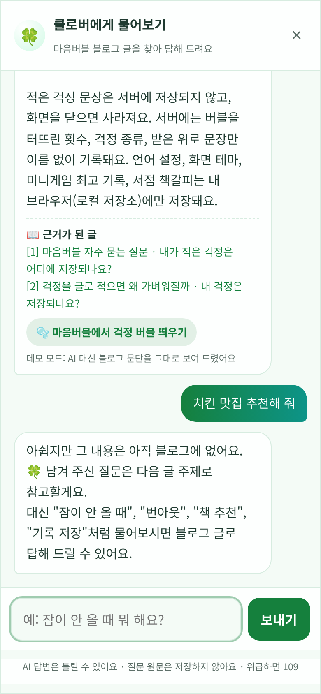
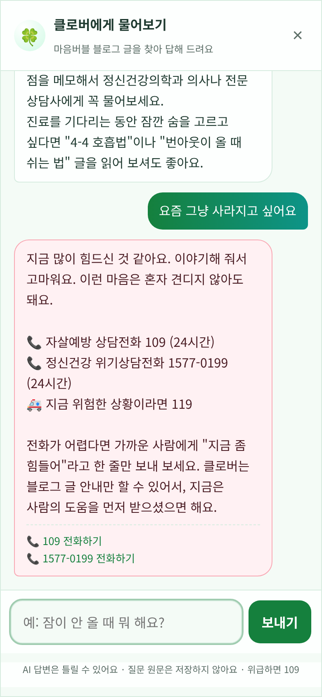

# 테스트 보고서 — 마음버블 블로그 「클로버에게 물어보기」

| 항목 | 내용 |
|---|---|
| 문서 버전 | v1.0 |
| 테스트 일자 | 2026-11-24 |
| 대상 | `main` 브랜치 (PRD v1.0 기준 기능) |
| 환경 | Node 22 `node:test` · Chromium(Playwright) 390×844 모바일 / 1280×800 데스크톱 · 로컬 서버 `npm run dev` |
| 결과 | **단위테스트 59/59 통과 (100%)** · 유저플로우 11개 화면 정상 · 콘솔 오류 0건 → P0·P1 기능 모두 통과, **출시 가능** (4장은 배포 직후 확인 후 v1.1로 갱신) |

## 1. 기능별 단위테스트 (`npm test`)

| 영역 | 파일 | 개수 | 주요 확인 내용 | 결과 |
|---|---|---|---|---|
| 마크다운 변환 | `markdown.test.js` | 6 | front-matter, 제목·목록·인용, **XSS 차단**(`<script>`, `javascript:` 링크) | ✅ 6/6 |
| 원고·문단 나누기 | `posts.test.js` | 5 | 원고 7편 필수 항목·`feature` 값, 소제목 단위 조각·출처 URL, 긴 문단 재분할 | ✅ 5/5 |
| 검색 품질 | `search.test.js` | 16 | 조사 제거, **답 있는 질문 10개 → 기대 글 상위 2위 이내**, **범위 밖 질문 5개 → 근거 없음** | ✅ 16/16 |
| 안전 규칙 | `safety.test.js` | 13 | **위기 표현 7개 감지**, 오탐 4개 방지(책 제목 『죽고 싶지만 떡볶이는…』 포함), 109·1577-0199·119 안내, 진단·약 질문 감지 | ✅ 13/13 |
| 입력·남용 방지 | `validate.test.js` | 4 | 빈 값·300자 초과 거절, 전화번호·이메일·주민번호 마스킹, 분당 10회 제한 후 해제 | ✅ 4/4 |
| 챗봇 흐름 | `clover.test.js` | 10 | AI 정상 답변+출처+기능 링크, 위기·의료·범위 밖은 **AI 미호출**, `[[NO_ANSWER]]` 처리, AI 오류·15초 초과 시 데모 답변 | ✅ 10/10 |
| 빌드 산출물 | `build.test.js` | 5 | 홈·글·404·검색 색인 생성, 브라우저 코드에 `node:` 모듈 없음, **모든 페이지에 챗봇·109 표시**, 키 미포함 | ✅ 5/5 |

PRD 3장 지표와의 연결: 위기 대응 100%(안전 13/13), 범위 밖 정직성 100%(5/5), 출처 포함 답변 100%(답 있는 질문 10/10).
문제 정의(PRD 2장)와의 연결: ① 답이 어느 글에 있는지 모름 → 검색 품질·출처 / ② 이탈 → 기능 링크(챗봇 흐름, 화면 ②④) / ③ 안전 → 안전 규칙 / ⑤ 독자 궁금증 데이터 → 범위 밖 판정·갭 기록 / ④ 반복 응대 → 배포 URL 실사용 확인(4장).

## 2. 전체 유저플로우 (화면 스크린샷 — `docs/screenshots/`)

| ① 홈 | ② 글 하단 기능 버튼 | ③ 챗봇 열기 | ④ 답변 + 출처(데모) |
|---|---|---|---|
|  |  |  |  |
| 글 목록 + 질문 버튼 | 글 → 마음버블 유입 | 추천 질문 칩 4개 | 근거 글 2개 + 기능 링크 |

| ⑤ 범위 밖 질문 | ⑥ 진단·약 질문 | ⑦ 위기 표현 | ⑧ AI 답변(모의) |
|---|---|---|---|
|  |  |  |  |
| 지어내지 않음 + 갭 기록 | 의료진 상담 권유 | 109·1577-0199·119 + 전화 버튼 | 근거 번호 [1][2] 표시 |

그 밖에 글 상세·404·데스크톱 화면도 정상(`docs/screenshots/`). ⑧은 실제 Gemini 대신 **Firebase SDK를 모의 응답으로 바꿔** 화면 표시만 검증한 것이다. 실제 AI 응답은 배포 후 4장의 항목으로 확인한다.

## 3. 발견한 결함과 조치 (자세한 내용: `logs/SUCCESS_FAILURE_LOG.md`)

| # | 결함 | 발견 방법 | 조치 | 재검증 |
|---|---|---|---|---|
| 1 | "호흡은 어떻게 해요?"가 3점으로 근거 없음 판정 | 검색 점검 | 조사 제거 추가 | ✅ |
| 2 | "치킨 맛집 추천"이 서점 글로 답변(동의어 확장 부작용) | 범위 밖 테스트 | 질문 핵심어 커버리지 50% 기준 추가 | ✅ |
| 3 | "우울증 약 뭐 먹어야 해?" 의료 질문 미감지 | 브라우저 점검 | 말순서 패턴 추가 | ✅ |
| 4 | 데모 답변에서 목록이 한 줄로 붙음 | 화면 캡처 | 목록 기호 보존 | ✅ |
| 5 | 390px에서 헤더 두 줄로 깨짐, 버튼 문구 어색 | 화면 캡처 | 좁은 화면 메뉴 정리, 문구 수정 | ✅ |

## 4. 미검증 항목 (배포 직후 확인)

- **실제 Gemini 답변·속도**(작업 환경 외부 API 차단): 질문 20개로 출처 표기·평균 5초 확인
- **Firestore 규칙·App Check·웹폰트**: Rules Playground, 타 도메인 호출 차단, 배포 화면 확인
