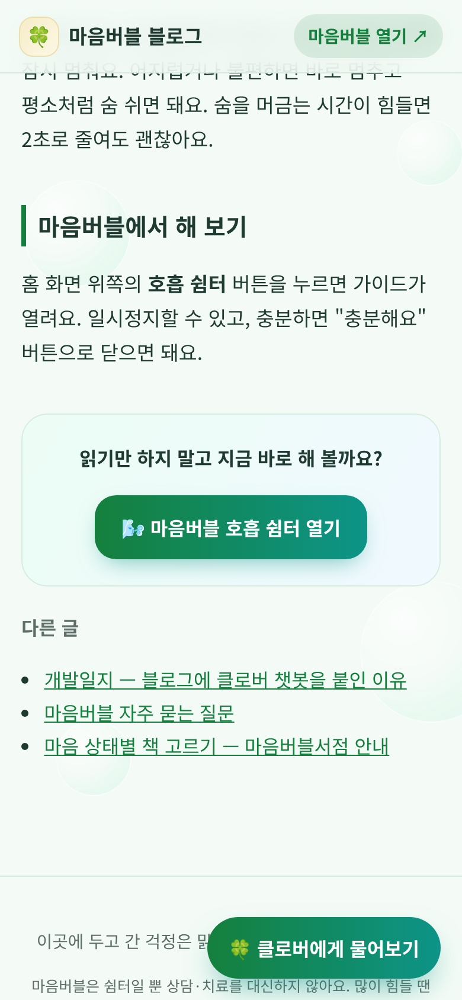
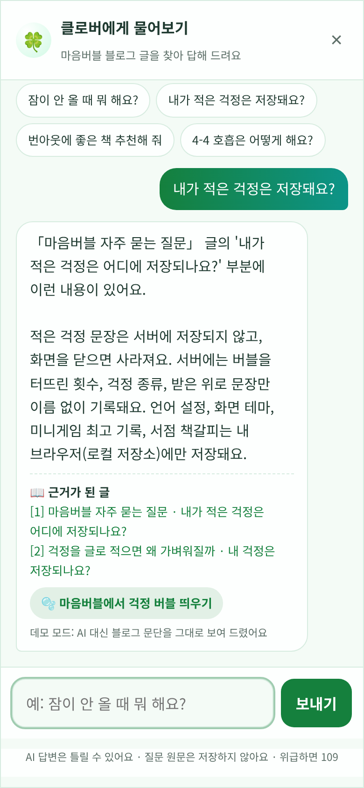
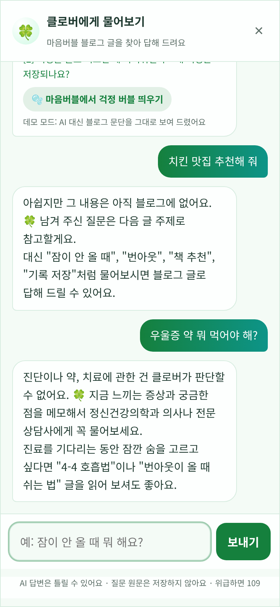
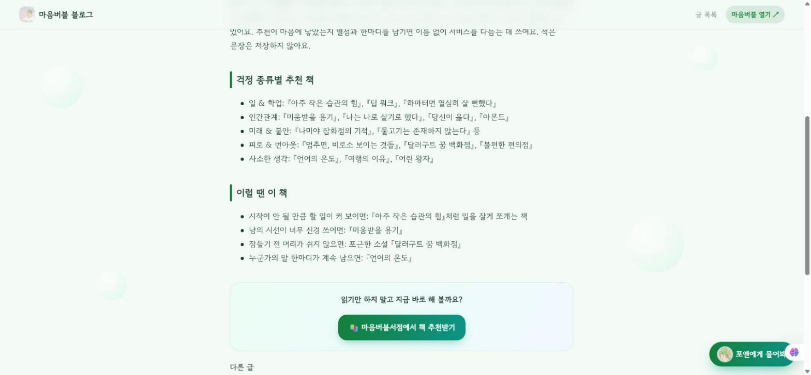
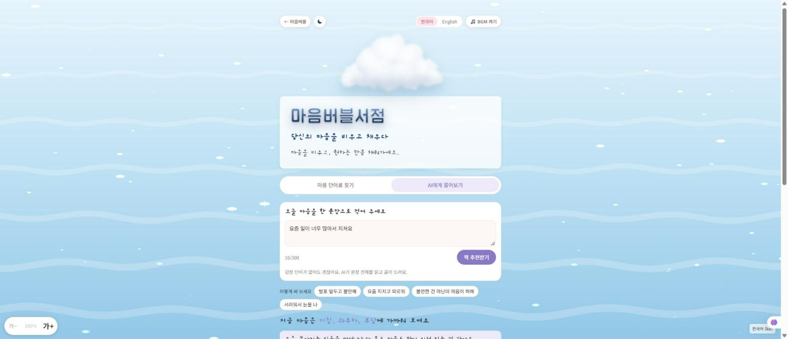
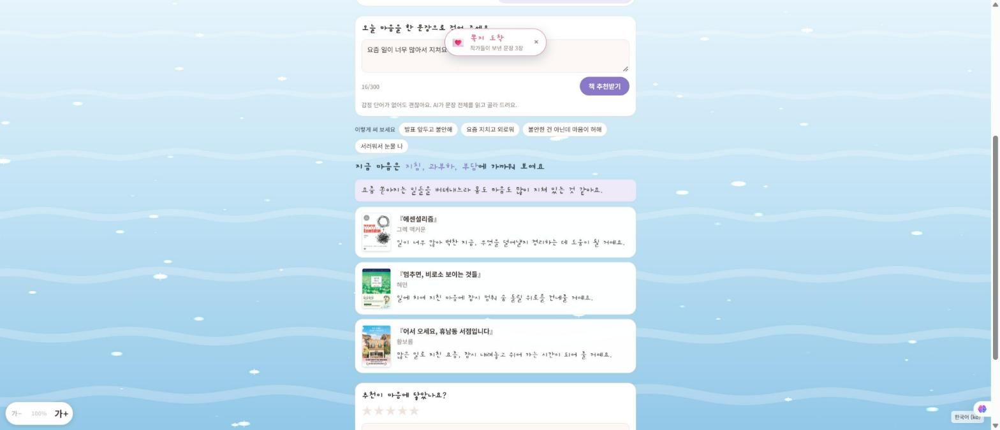

# 테스트 보고서 — 마음버블 블로그 「마음쉼터 서비스」

| 항목 | 내용 |
|---|---|
| 버전·일자 | v1.6 (마음버블 앱 단위테스트 10개 재실행·README v17과 수치 일치) · 2026-11-25 · 대상 `main` (PRD v3.3) · 배포 블로그 기준 |
| 환경 | Node 22 `node:test` · Chromium(Playwright) 390×844 모바일 / 1280×800 데스크톱 · 배포 주소(Firebase Hosting) |
| 결과 | **단위테스트 블로그 69/69 · 마음버블 앱 10/10 통과** · 유저플로우 14개 화면 정상 · CSP 위반 0건 · **배포 주소에서 포앤·서점 AI(Claude) 실제 답변 확인** → P0·P1 통과, **출시 가능** |

## 1. 기능별 단위테스트 (`npm test`)

| 영역 | 파일 | 개수 | 주요 확인 내용 | 결과 |
|---|---|---|---|---|
| 마크다운 변환 | `markdown` | 6 | front-matter, 제목·목록·인용, **XSS 차단**(`<script>`, `javascript:`) | ✅ |
| 원고·문단 | `posts` | 5 | 원고 필수 항목·`feature`, 소제목 단위 조각·출처 URL | ✅ |
| 검색 품질 | `search` | 16 | 조사 제거, **답 있는 질문 10개 → 기대 글 2위 이내**, **범위 밖 5개 → 근거 없음** | ✅ |
| 안전 규칙 | `safety` | 13 | **위기 표현 7개 감지**, 오탐 4개 방지, 109·1577-0199·119, 진단·약 질문 감지 | ✅ |
| 입력·남용 방지 | `validate` | 4 | 빈 값·300자 초과 거절, 전화·이메일·주민번호 마스킹, 분당 10회 제한 | ✅ |
| 챗봇 흐름 | `clover` | 11 | 답변+출처+기능 링크, 위기·의료·범위 밖 **AI 미호출**, `[[NO_ANSWER]]`, 오류·15초 초과 시 데모 답변, 근거 번호=출처 번호 | ✅ |
| 빌드·설정·보안 | `build`·`config` | 14 | 전 페이지 챗봇·109·처리방침, **키 미포함**, CSP·인라인 금지, 샘플 설정만 커밋, 아이콘 통일, 자산 `?v=` | ✅ |
| 마음버블 앱 | `maeumbubble-app` (`npx vitest run`) | 10 | 「퇴사할게요」 제출·도장, 404·로더 오류 화면, 키보드 조작(체크박스·라디오·아코디언·메뉴), SSR 라우터, 정적 빌드(6개 화면) 통과 | ✅ |

PRD 5장 지표 연결: 위기 대응 100%(13/13) · 범위 밖 정직성 100%(5/5) · 출처 포함 답변 100%(10/10).

## 2. 전체 유저플로우 (화면 스크린샷 — `docs/screenshots/`)

| ① 홈 | ② 글 하단 버튼 | ③ 챗봇 열기 | ④ 답변+출처 |
|---|---|---|---|
|  |  |  |  |
| 글 목록 + 질문 버튼 | 마음버블 유입 | 추천 질문 4개 | 근거 글 + 기능 링크 |

| ⑤ 범위 밖 | ⑥ 진단·약 | ⑦ 위기 표현 | ⑧ AI 답변 |
|---|---|---|---|
|  |  |  |  |
| 지어내지 않음 + 갭 기록 | 의료진 상담 권유 | 109·1577-0199·119 | 근거 번호 [1][2] |

| ⑨ 글 → 서점(UTM) | ⑩ 마음버블서점 | ⑪ 서점 AI 추천 |
|---|---|---|
|  |  |  |

글 상세·404·데스크톱도 정상. ⑧은 모의 응답, 실제 답변은 4장. ⑨~⑪은 11-25 배포 주소.

## 3. 결함과 조치 (자세히: `logs/SUCCESS_FAILURE_LOG.md`)

① 조사 붙은 질문 → 조사 제거 ② 범위 밖 질문에 서점 글 → 핵심어 50% 기준 ③ 의료 질문 말순서 → 패턴 추가 ④ 데모 답변 목록 → 기호 보존 ⑤ 390px 헤더 → 메뉴 정리 ⑥ 서점 AI 서버(Supabase) 소멸 → Cloudflare 이식 ⑦ 로컬 127.0.0.1 403 → 허용 추가. **모두 재검증 ✅**

## 4. 배포 후 검증 (11-24·11-25, 실제 Chrome)

| 항목 | 결과 |
|---|---|
| 블로그 | ✅ 홈·글·처리방침·404 가로 넘침·콘솔 오류 없음, CSP 위반 0건, UTM 포함 · 포앤 실제 AI 답변 근거 번호·출처 표시 4.6~5.1초, 타 도메인 403 ([답변](screenshots/deploy-02-answer.png)·[범위 밖](screenshots/deploy-04-out-of-scope.png)·[위기](screenshots/deploy-06-crisis.png)·[처리방침](screenshots/deploy-07-privacy.png)) |
| 마음버블 앱·서점 | ✅ 홈·미니게임·타이핑·처리방침 링크 · `/books` → `/bookstore/` 302, 표지·BGM 200, 서점 AI 추천(감정·책 3권·이유) 4.6~6.9초, 타 도메인 403, 별점 저장(로컬 KV) 200 |

**상용화 계획**: 서점 표지를 알라딘·카카오 책 검색·국립중앙도서관 API 표지 URL로 바꿀 때 응답(200)·책 정보 일치, 누락 시 이모지 대체, CSP 이미지 도메인 추가, 키는 서버 비밀값·한도 초과 동작을 확인한다.
